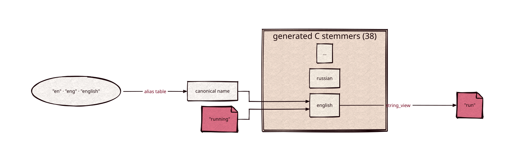

# snowball

[](https://github.com/Kronuz/snowball/actions/workflows/ci.yml)
[](LICENSE)


The [Snowball](https://snowballstem.org/) stemmers for C++20: the C code Snowball
generates for all 38 of its algorithms, checked in, behind a small C++ API. The pinned
Snowball commit (`tools/SNOWBALL_COMMIT`) stems exactly as Xapian 2.1.0 does.



## ✨ Highlights

- `snowball::stemmer(language)`: a stemmer for a canonical name (`"english"`) or an
  alias (`"en"`, `"eng"`, `"kraaij_pohlmann"`); an unknown name throws
  `std::invalid_argument`.
- `stem(word)`: stems a UTF-8 word and returns a `std::string_view` that stays valid
  until the next call. A stemmer is not thread-safe; use one per thread.
- `stemmer::languages()`: the 38 canonical names, sorted. `stemmer::canonical(name)`
  resolves an alias.

Languages: arabic, armenian, basque, catalan, czech, danish, dutch, dutch_porter,
earlymodernenglish, english, esperanto, estonian, finnish, french, german, greek,
hindi, hungarian, indonesian, irish, italian, lithuanian, lovins, nepali, norwegian,
persian, polish, porter, portuguese, romanian, russian, serbian, sesotho, spanish,
swedish, tamil, turkish, yiddish.

## 📦 Installation

Requires a C++20 compiler; CMake 3.14 or newer for the CMake route. CI builds it on
Linux (x86_64, arm64), macOS (arm64, x86_64), and FreeBSD, plus ASan, UBSan, and TSan
builds.

```cmake
include(FetchContent)
FetchContent_Declare(snowball
  GIT_REPOSITORY https://github.com/Kronuz/snowball.git
  GIT_TAG        main)
FetchContent_MakeAvailable(snowball)

target_link_libraries(my_app PRIVATE snowball::snowball)
```

## 🚀 Quick start

```cpp
#include "snowball.hh"

#include <cassert>

int main() {
	snowball::stemmer stem("english");
	assert(stem("running") == "run");   // valid until the next call
}
```

## 🧪 Correctness

The test stems a 500-word sample of every language (19,003 words) against vectors.
Across the full [snowball-data](https://github.com/snowballstem/snowball-data)
vocabularies (11,648,988 words in 38 languages), every stem equals Xapian 2.1.0's
`Xapian::Stem`, also under ASan and UBSan. `fuzz/fuzz_stem.cc` is a libFuzzer target
that stems arbitrary bytes in every language (50 million runs clean).

## ⚡ Performance

Stemming the snowball-data vocabularies on an Intel i9-9980HK, Apple clang `-O3`
(`bench/bench.cc`): english 220 ns per word, russian 233 ns, german 355 ns.

## 🔁 Regenerating

```sh
tools/regenerate.sh [COMMIT]   # defaults to tools/SNOWBALL_COMMIT
```

It builds the Snowball compiler at the commit and rewrites `generated/`, `runtime/`,
`tools/modules.txt`, and `LICENSE-SNOWBALL`. Every external C symbol and runtime struct
gets a `kronuz_snowball_` prefix, so the library links beside libstemmer.

## 🛠️ Building and testing

```sh
cmake -S . -B build && cmake --build build && ctest --test-dir build
build/snowball_stem english < words
```

## 🎯 When to use it

- ✅ Stemming for search in any of 38 languages, matching Xapian's stems.
- ❌ Lemmatization (dictionary forms) or morphology: stems are not words.

## 📚 Documentation

- [AGENTS.md](AGENTS.md): repository map and invariants.

## 🤝 Contributing

Issues and pull requests are welcome. Read [AGENTS.md](AGENTS.md) first. CI must
pass on every platform.

## 📄 License

MIT, Copyright (c) 2026 Germán Méndez Bravo. See [LICENSE](LICENSE).
The generated stemmers and runtime are Snowball's, under the BSD 3-clause
license; see [LICENSE-SNOWBALL](LICENSE-SNOWBALL).
